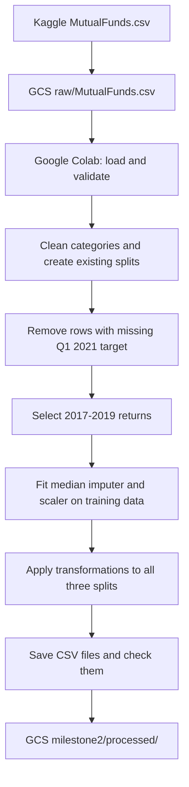

Milestone 2 — Data Understanding and Pipeline Setup
Data Handling and Infrastructure for AI
GitHub: https://github.com/conorweekes/mutual-funds-ml-pipeline

## 1. Project definition

The aim of my project is to see whether previous mutual fund returns can help predict a fund's return in the first quarter of 2021. The target column is `fund_return_2021_q1`. Since I am trying to predict a number rather than a category, this is a regression task.

The idea is to use information from before 2021 to predict Q1 2021, then eventually compare the predictions with the actual returns already recorded in the dataset. This project is for learning about financial data and machine learning rather than making investment recommendations.

In M1 I identified a wider range of possible inputs, including fund characteristics and 2020 returns. For M2 I have started with just the annual returns from 2017, 2018 and 2019. I chose these as a simpler starting point because I still need to confirm when some of the other information was available. The model will be trained and evaluated in M3, not M2.

For this milestone I wanted the notebook to load the data, find quality issues, prepare the existing training, development and test sets, and produce files that can be read back from storage.

## 2. Data source

I am using the Mutual Funds and ETFs dataset provided by Stefano Leone on Kaggle. The file used for this project is `MutualFunds.csv`.

Dataset link: https://www.kaggle.com/datasets/stefanoleone992/mutual-funds-and-etfs

As explained in M1, I downloaded the original CSV and uploaded it to Google Cloud Storage (GCS). I am keeping this copy unchanged so I can always recreate the processed data if I need to change my code.

Regarding Ethical considerations, the dataset contains publicly avaialable fund information rather than personal data, so privacy shouldn't be concern. 

Original file:

`gs://conor-weekes-data-20084449/raw/MutualFunds.csv`

I chose GCS instead of a database because I am mainly working with one CSV dataset and processing it in batches. I access the bucket in Google Colab using Google authentication, without putting passwords or keys in the notebook. My M1 README also explains the storage decision and versioning setup.

The dataset was downloaded from Kaggle and published by Stefano Leone. The data was originally collected from Yahoo Finance. An independent dataset catalogue lists the licence as CC0: Public Domain. I am using the dataset for educational purposes.

The information used in my initial model concerns mutual funds rather than individual customers. However, the original dataset contains other fields, including management information, which I do not need in my processed files. Possible limitations include missing historical records, funds with shorter histories, selection bias and inaccuracies in the published data. I have not independently verified the original returns against another financial data provider.

## 3. Data description

The original dataset contains 23,783 rows and 298 columns. Each row represents a mutual fund record, and `fund_symbol` is used as the identifier. The dataset contains numerical returns, fund categories, financial measures and text information. There are historical return columns covering years before 2021, as well as columns from 2021.

The initial cleaning from M1 was kept. I removed rows with a missing `fund_category` and categories containing fewer than 10 funds. This left 23,069 rows across 108 categories. I also kept the existing split method: 80% training, 10% development and 10% testing, stratified by `fund_category` with `random_state=42`.

For the regression task, 441 of the cleaned funds did not have a Q1 2021 return. These records were removed from copies of the existing splits, leaving 22,628 funds with known target values.

| Dataset | Rows available for regression |
|---|---:|
| Training | 18,107 |
| Development | 2,265 |
| Testing | 2,256 |
| Total | 22,628 |

The original M1 datasets and split assignments were not overwritten.

In terms of known limitations, some historical fund returns are missing, and 441 funds have no recorded Q1 2021 return. There are also potential outliers in the returns data.

## 4. Exploratory data analysis

I used pandas in Google Colab to look at missing values, data types, duplicates, fund categories and the distribution of Q1 2021 returns. I followed the approaches covered in the Week 4 and Week 5 labs.

Missing data: The schema audit showed that some columns contain very little information. For example, `last_cap_gain` had 23,776 missing values, while `fund_return_2021_q3` had 23,721 missing values in the original data. This is one reason I did not use every available column as a model input.

Q1 2021 returns: Out of the cleaned data, there were 22,628 known target values and 441 missing values. I calculated the following statistics:

| Measure | Result |
|---|---:|
| Mean return | 3.74% |
| Median return | 2.51% |
| Standard deviation | 6.05 percentage points |
| Lowest return | -26.32% |
| Highest return | 60.54% |
| Skewness | 1.49 |

I also created a histogram which showed that most funds had lower returns, while a smaller number had much higher returns. This shows why the mean was higher than the median, since the higher returns pulled the average up.

Using the 1.5 × IQR rule, I found 1,315 potential outliers (5.81%). I decided not to remove these because high or low investment returns could be genuine.

I checked the cleaned dataset and found that there were no missing fund symbols or fund categories. There were also no duplicate fund symbols. I also checked that the Q1 2021 return was stored as a numerical value.

Historical return availability: After removing missing target rows, I checked the historical features I might use:

| Return column | Missing values | Available |
|---|---:|---:|
| 2017 | 4,067 | 82.03% |
| 2018 | 2,700 | 88.07% |
| 2019 | 1,571 | 93.06% |
| 2020 | 825 | 96.35% |

The more recent years had fewer missing values. I selected 2017 to 2019 as the first three input features. I also identified `fund_return_2021_q2` and `fund_return_2021_q3` as columns that must not be used to predict Q1 2021, since they contain information from later periods.

## 5. Design / Architecture

I am continuing to use Google Cloud Storage for the original and processed data, and Google Colab to run the Python notebook. The raw data stays separate from the M1 shards and M2 processed files.

The first upload from Kaggle was manual. The loading, validation, cleaning, splitting, preprocessing and CSV generation are carried out by the notebook. I still have to authenticate to GCS when opening a new Colab session. The M2 upload code checks for existing destination files and skips them instead of overwriting them.

The processed outputs are stored here:

`gs://conor-weekes-data-20084449/milestone2/processed/`

This is separate from the original `raw/` and `sharded/` folders.

## 6. Implementation

I used pandas for data inspection and cleaning and scikit-learn for the preprocessing pipeline. I kept the M1 train, development and test split assignments and removed the 441 rows with missing targets separately from each one.

My initial numerical pipeline has two steps:

1. `SimpleImputer(strategy="median")` , this fills missing historical returns using medians calculated from the training data only.
2. `StandardScaler` this standardises the three input features. It is also fitted using the training data only.

I used the training data to calculate the median values and scaling settings. I then used these same values on the development and test datasets, rather than calculating new ones for each dataset , this should prevent data leakage.

I made an audit table to record how many missing values were filled and which medians were used:

| Feature | Values filled | Training median |
|---|---:|---:|
| `fund_return_2017` | 4,067 | 0.14006 |
| `fund_return_2018` | 2,700 | -0.05369 |
| `fund_return_2019` | 1,571 | 0.20198 |
| Total | 8,338 | |

These are missing values, not necessarily 8,338 different funds. The 441 missing Q1 2021 target values were not filled; those rows were excluded from the regression datasets. 

The pipeline saved three files locally in Colab and then uploaded them to GCS:

| File | Rows | Columns |
|---|---:|---:|
| `train_processed.csv` | 18,107 | 5 |
| `dev_processed.csv` | 2,265 | 5 |
| `test_processed.csv` | 2,256 | 5 |

Each file has the three processed historical return columns, the fund symbol and the actual Q1 2021 return. The return inputs have been standardised, while the target keeps its original values.

I checked that the processed files could be read locally and again from GCS. All three contained zero missing values. I also checked the split identifiers, with zero fund symbol overlaps between training, development and testing.

Reproducing the work: I tested the M2 notebook by restarting Google Colab and running the code again from the beginning. Everything ran without any errors and I got the same results as before.

To run the notebook, the user will need access to Google Colab and the required Python libraries, including pandas, scikit-learn, Matplotlib, google-cloud-storage and gcsfs. They will also need permission to access the dataset stored in my Google Cloud Storage bucket.

The M2 notebook is added in GitHub alongside the original M1 notebook to make it easier to review. A `requirements.txt` has been added for someone using a different setup and to clearly state dependencies.

The user would first need to open the notebook in Colab, install the required libraries and sign in to their Google account. After that, they can run the remaining cells in order to load the data, review, clean the missing values and save the processed datasets.

I also disabled the original Milestone 1 upload code so that running the notebook again would not accidentally overwrite any of the files I had previously stored in Google Cloud Storage. 

## 7. Next steps

For Milestone 3, I plan to:

- Check whether I can find out which fund information was available before Q1 2021, so I don't accidentally use information from later periods when making predictions.
- Revisit the cross-validation folds created in M1, since they were made before removing the missing Q1 2021 target rows.
- Review whether retaining outliers, filling historical returns with medians or adding missing value indicators affects model performance.
- In M3, I plan to start with a simple model and compare its predicted fund returns with the actual returns to see how well it performs and go from there.

References used: [M1 README](https://github.com/conorweekes/mutual-funds-ml-pipeline/blob/main/README.md), [Kaggle dataset](https://www.kaggle.com/datasets/stefanoleone992/mutual-funds-and-etfs), the course's Week 4 and Week 5 labs, the Milestone 2 grading guide, [pandas documentation](https://pandas.pydata.org/docs/) and [scikit-learn documentation](https://scikit-learn.org/stable/).

AI use: I used ChatGPT GPT-6 to help me understand the lecture notes and lab exercises, adapt code from the labs to work with my mutual funds dataset, and fix errors I came across. I also used it to help organise and write parts of this report. I ran the code myself in Google Colab and checked the results to make sure they were correct.
